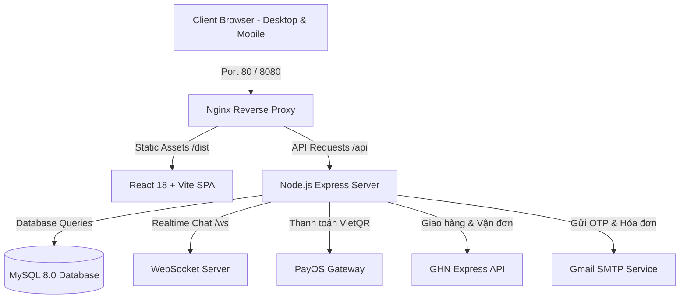

# 🎵 VỌC RECORDS — NỀN TẢNG THƯƠNG MẠI ĐIỆN TỬ VINYL & ANALOG AUDIO

<p align="center">
  
</p>

<p align="center">
  <strong>Website thương mại điện tử chuyên kinh doanh Đĩa Than (Vinyl), Băng Cassette, Mâm Đĩa (Turntable) và Phụ Kiện Âm Thanh Analog.</strong>
  <br />
  Giao diện đơn giản theo phong cách <strong>Shopify</strong>: cửa hàng giống theme Dawn, trang quản trị giống Shopify Admin.
</p>

<p align="center">
  
  
  
  
  
  
  
</p>

---

## 📑 Mục Lục
- [Giới Thiệu](#-giới-thiệu)
- [Tính Năng Nổi Bật](#-tính-năng-nổi-bật)
  - [1. Dành Cho Khách Hàng (Storefront)](#1-dành-cho-khách-hàng-storefront)
  - [2. Quản Trị Hệ Thống (Admin Panel)](#2-quản-trị-hệ-thống-admin-panel)
  - [3. Trợ Lý Mua Sắm AI & Tìm Kiếm Thông Minh](#3-trợ-lý-mua-sắm-ai--tìm-kiếm-thông-minh)
- [Kiến Trúc & Công Nghệ](#-kiến-trúc--công-nghệ)
- [Cấu Trúc Thư Mục](#-cấu-trúc-thư-mục)
- [Hướng Dẫn Cài Đặt & Chạy Ứng Dụng](#-hướng-dẫn-cài-đặt--chạy-ứng-dụng)
  - [Chạy bằng Docker Compose (Khuyên dùng)](#cách-1-chạy-bằng-docker-compose-nhanh-nhất--khuyên-dùng)
  - [Chạy môi trường phát triển (Local Development)](#cách-2-chạy-phát-triển-local-development)
- [Cấu Hình Biến Môi Trường (.env)](#-cấu-hình-biến-môi-trường-env)
- [Cơ Sở Dữ Liệu & Sao Lưu (Backup / Restore)](#-cơ-sở-dữ-liệu--sao-lưu-backup--restore)
- [Tài Khoản Mẫu Trải Nghiệm](#-tài-khoản-mẫu-trải-nghiệm)
- [Thông Tin Cửa Hàng & Liên Hệ](#-thông-tin-cửa-hàng--liên-hệ)

---

## 📻 Giới Thiệu

**Vọc Records** là giải pháp nền tảng E-Commerce toàn diện dành cho cộng đồng yêu âm nhạc Analog tại Việt Nam:
- **Địa chỉ Showroom**: 54 Triều Khúc, Phường Thanh Xuân Nam, Quận Thanh Xuân, Hà Nội.
- **Hotline / Hỗ trợ**: 0766 255 478.
- **Đặc trưng thiết kế**: Phong cách tối giản theo Shopify — nền trắng, chữ Inter, viền mảnh, bo góc nhẹ, nhiều khoảng trắng; trang quản trị dùng bố cục menu trái + thẻ (card) giống Shopify Admin (Polaris). Hiển thị tốt trên cả Desktop và Mobile.

---

## ✨ Tính Năng Nổi Bật

### 1. Dành Cho Khách Hàng (Storefront)
- **Danh mục chuyên biệt**:
  - **Đĩa Than (Vinyl Records)**: Tuyển tập album kinh điển và hiện đại, phân loại chi tiết theo thể loại (Rock, Jazz, City Pop, Việt Nam, Electronic...), tình trạng bìa/đĩa và tracklist bài hát.
  - **Băng Cassette**: Album băng từ hoài niệm, âm thanh mộc mạc.
  - **Mâm Đĩa Than (Turntables)**: Các dòng mâm đĩa chính hãng (Audio-Technica, Pro-Ject, Sony...).
  - **Phụ Kiện Chăm Sóc**: Chổi quét carbon, dung dịch vệ sinh đĩa, bọc lót trong/ngoài cao cấp.
- **Tìm kiếm & Bộ lọc nâng cao**: Lọc sản phẩm theo danh mục, khoảng giá, thể loại nhạc và tình trạng tồn kho.
- **Giỏ Hàng (Cart) & Yêu Thích (Wishlist)**: Đồng bộ giỏ hàng và danh sách đĩa yêu thích theo thời gian thực.
- **Cổng Thanh Toán Tích Hợp**:
  - **COD (Thanh toán khi nhận hàng)**: Tiện lợi, an toàn.
  - **VietQR PayOS (Tự động đối soát)**: Tạo mã QR thanh toán ngân hàng tức thời, tự động nhận diện thanh toán thành công trong 2-3 giây.
  - **Bộ đếm thời gian PayOS (10 phút)**: Tự động đếm ngược; nếu quá hạn mà chưa chuyển khoản, hệ thống sẽ tự hủy đơn và **tự động hoàn lại số lượng tồn kho** cho sản phẩm.
- **Tích Hợp Giao Hàng Nhanh (GHN Express)**:
  - Tự động lấy danh mục Tỉnh/Thành, Phường/Xã chuẩn GHN API.
  - Tính cước phí vận chuyển chính xác theo địa chỉ thực tế của khách hàng.
  - Tra cứu mã vận đơn trực tiếp trên đơn hàng.
- **Quản Lý Tài Khoản (Account Dashboard)**:
  - Thống kê tổng số đơn hàng, đơn đang xử lý/giao, đơn hoàn thành và sản phẩm yêu thích.
  - **Sổ Địa Chỉ (GHN)**: Quản lý nhiều địa chỉ giao hàng, đặt địa chỉ mặc định, thêm/xóa địa chỉ thuận tiện.
  - **Chi Tiết Đơn Hàng**: Xem lại lộ trình đơn hàng, tình trạng giao hàng, chi tiết từng đĩa nhạc.
  - **Quy trình Hủy Đơn & Hoàn Tiền (Refund)**: Đối với đơn đã thanh toán online qua PayOS, khách hàng nhập form thông tin ngân hàng nhận lại tiền (Ngân hàng, STK, Tên chủ TK, Lý do) một cách minh bạch. Hệ thống tự động khóa nút hủy nếu đơn đã được tạo mã vận đơn GHN để bảo vệ đơn hàng đang vận chuyển.
  - **Đổi Mật Khẩu & Xác Thực OTP**: Bảo mật tài khoản với xác thực mã OTP qua Email.
- **Tương Tác & Cộng Đồng**:
  - **Chat Trực Tuyến Realtime**: Nhắn tin trực tiếp với nhân viên hỗ trợ qua WebSocket (tự động fallback sang REST API khi mất kết nối).
  - **Hỏi Đáp Sản Phẩm (Q&A)**: Khách hàng có thể đặt câu hỏi về album/thiết bị ngay dưới trang chi tiết sản phẩm.
  - **Blog & Hướng Dẫn Kỹ Thuật**: Cẩm nang bảo quản đĩa than, cân chỉnh cần kim mâm đĩa, review album kinh điển.

---

### 2. Quản Trị Hệ Thống (Admin Panel)
- **Bảo toàn Route & Trạng thái**: Tự động đồng bộ URL Search Params (`?tab=orders`, `?tab=products`...) và `localStorage`, ấn F5 / reload không bao giờ bị nhảy tab về Dashboard.
- **Dashboard & Báo Cáo Doanh Thu**:
  - Thống kê doanh thu hôm nay, tổng số đơn, số lượng khách hàng và biểu đồ tăng trưởng doanh thu theo ngày bằng Chart.js.
  - **Xuất Báo Cáo Doanh Thu Ra Excel**: Nút xuất file Excel (CSV chuẩn ký tự UTF-8 BOM `\uFEFF`) hiển thị tiếng Việt hoàn hảo, mở trực tiếp trên Microsoft Excel không bị lỗi font.
- **Quản Lý Đơn Hàng Toàn Diện**:
  - Danh sách đơn hàng với đầy đủ thông tin: Mã ĐH, Khách hàng, Thời gian, Tổng tiền, GHN, Trạng thái đơn, Cảnh báo hoàn tiền.
  - **Xem Chi Tiết Đơn Hàng (Modal Popup)**: Xem chi tiết người nhận, địa chỉ giao hàng, ghi chú, phương thức thanh toán, mã vận đơn GHN, bảng chi tiết từng sản phẩm và tổng tiền.
  - **Xuất / In Hóa Đơn Bán Lẻ (Retail Invoice)**: Nút xuất hóa đơn chuẩn khổ giấy A4 mang nhận diện thương hiệu Vọc Records (đầy đủ địa chỉ 54 Triều Khúc, hotline, chi tiết sản phẩm, tổng tiền, chữ ký xác nhận), hỗ trợ in trực tiếp hoặc lưu dưới dạng PDF chỉ với 1 click.
  - **Kiểm Soát Vận Đơn GHN**: Nút "TẠO GHN" được kiểm soát chặt chẽ — chỉ mở kích hoạt khi đơn đã ở trạng thái `ĐÃ XÁC NHẬN`, ngăn chặn tạo nhầm đơn vận chuyển.
  - **Xử Lý Hoàn Tiền Bán Tự Động**: Hiển thị thẻ cảnh báo đỏ nổi bật đối với các đơn hàng đã thanh toán bị hủy, hiển thị chi tiết số tài khoản ngân hàng của khách và nút bấm "✓ Xác nhận đã chuyển khoản" để đóng quy trình hoàn tiền.
- **Quản Lý Kho Hàng & Sản Phẩm (Inventory & Catalog)**:
  - Thêm mới, chỉnh sửa thông tin, giá bán, tồn kho, nhóm sản phẩm, thể loại, định dạng bìa đĩa, quy cách, tracklist bài hát và hình ảnh.
- **Quản Lý Khách Hàng**: Theo dõi lịch sử mua hàng, tổng chi tiêu của từng khách hàng.
- **Quản Lý Đổi Trả / Khiếu Nại (Returns)**: Quy trình tiếp nhận yêu cầu đổi trả, kiểm tra và chỉ hoàn lại số lượng tồn kho khi đơn đổi trả chuyển sang trạng thái `Hoàn tất`.
- **Hỏi Đáp Sản Phẩm & Chat CSKH**: Duyệt/ẩn bình luận hỏi đáp và giao diện trả lời tin nhắn trực tiếp với khách hàng.
- **Quản Lý Nội Dung (CMS)**: Soạn thảo, xuất bản và quản lý bài viết Blog, bài Hướng dẫn kỹ thuật.
- **Mã Giảm Giá (Discount Vouchers)**: Quản lý mã khuyến mãi, phần trăm chiết khấu hoặc giảm tiền mặt cố định.
- **Phân Quyền Nhân Sự**: Quản lý tài khoản nhân viên và phân chia quyền hạn chặt chẽ (Admin / Nhân viên).

### 3. Trợ Lý Mua Sắm AI & Tìm Kiếm Thông Minh

| Tính năng | Cách làm | Chi phí |
| :--- | :--- | :--- |
| **Tìm kiếm thông minh** (`/search`, ô tìm kiếm trên header) | Tách điều kiện cứng (giá "dưới 800k", "1tr2", loại, còn hàng) → BM25 tiếng Việt có dấu/không dấu + embedding `multilingual-e5-small` → gộp hai bảng xếp hạng bằng Reciprocal Rank Fusion | Miễn phí, chạy cục bộ |
| **Tìm bằng ảnh bìa** (nút "Tìm bằng ảnh bìa") | Mô hình CLIP chạy ngay trong trình duyệt (Web Worker + WebAssembly), chỉ gửi vector 512 số lên server so với vector ảnh bìa sản phẩm; trình duyệt yếu thì server tự chạy CLIP | Miễn phí, chạy cục bộ |
| **Trợ lý chat AI** (nút "Trợ lý AI" góc phải) | Claude gọi công cụ (`search_products`, `get_product`, `add_to_cart`, `check_discount`, `get_my_orders`) trên dữ liệu thật, trả lời dạng stream (SSE), tự thêm vào giỏ khi khách yêu cầu | Cần `ANTHROPIC_API_KEY`; không có key thì widget tự chuyển sang tìm kiếm thông minh |
| **MCP server** (`mcp/`) | Claude Desktop tìm đĩa, xem trước và đặt đơn COD, theo dõi đơn qua REST API của cửa hàng. Hướng dẫn: [`mcp/README.md`](mcp/README.md) | Theo gói Claude của người dùng |

Câu thử: *"nhạc buồn nghe lúc mưa, dưới 800k"*, *"jazz thư giãn quán cà phê"*, *"mâm đĩa cho người mới tầm 5 triệu"*, *"cassette dưới 450k"*.

- Mỗi sản phẩm có ô **Từ khóa cho tìm kiếm AI** (tâm trạng, dịp nghe) trong form quản trị; catalog mẫu đã được điền sẵn (migration `09_ai_search.sql`).
- Mô hình (~250MB) tải từ Hugging Face ở lần chạy đầu, lưu ở volume `model_cache`; vector sản phẩm lưu trong bảng `SanPhamVector` và tự tính lại khi sản phẩm đổi nội dung.
- Mô hình chưa tải xong hoặc không tải được: tìm kiếm tự lùi về từ khóa, không báo lỗi cho khách.
- API: `GET /api/search?q=...&mode=hybrid|semantic|keyword&max_price=&category=`, `GET /api/search/status`, `POST /api/search/image`, `POST /api/assistant/chat` (SSE).

---

## 🛠 Kiến Trúc & Công Nghệ



### Công Nghệ Sử Dụng
| Thành Phần | Công Nghệ / Thư Viện |
| :--- | :--- |
| **Frontend** | React 18 (JavaScript/JSX), Vite, React Router v7, Lucide React, Chart.js, CSS thuần theo phong cách Shopify |
| **Backend** | Node.js, Express.js, MySQL2 (Connection Pool), WebSocket (`ws`), JWT, Bcrypt |
| **Cơ sở dữ liệu** | MySQL 8.0 (InnoDB, `utf8mb4_unicode_ci`) |
| **Bên thứ ba** | Cổng thanh toán VietQR PayOS, Giao Hàng Nhanh (GHN), Nodemailer (Gmail SMTP) |
| **DevOps / Hosting** | Docker, Docker Compose, Nginx, AWS Lightsail / EC2 Ubuntu |

---

## 📂 Cấu Trúc Thư Mục

```text
vocrecord/
├── DiaNhac/                    # Mã nguồn Frontend (React + Vite)
│   ├── public/                 # Ảnh tĩnh, logo, catalog sản phẩm
│   ├── src/
│   │   ├── app/
│   │   │   ├── components/     # Header, ProductCard, Modal..., admin/ (các mục trang quản trị)
│   │   │   ├── context/        # CartContext, WishlistContext
│   │   │   ├── pages/          # Home, Shop, ProductDetail, Cart, Checkout, Account, Admin, OrderDetail...
│   │   │   ├── hooks/          # useProducts, useChatRoom, useCountdown
│   │   │   ├── utils/          # api (gọi API), auth (phiên đăng nhập), format, status
│   │   │   ├── ai/             # Web Worker chạy CLIP trong trình duyệt (tìm bằng ảnh)
│   │   │   ├── routes.jsx      # Cấu hình định tuyến
│   │   │   └── config/api.js   # Cấu hình API Endpoint
│   │   └── styles/             # theme.css (biến màu), shared.css (thành phần chung), pages/*.css
│   ├── package.json
│   └── vite.config.js
│
├── server/                     # Mã nguồn Backend (Node.js + Express)
│   ├── src/
│   │   ├── config/             # Cấu hình kết nối MySQL pool
│   │   ├── middleware/         # Auth JWT, phân quyền, rate limit, error handler
│   │   ├── models/             # Data access models (SanPham, DonHang, TaiKhoan...)
│   │   ├── routes/             # REST API routes (order, product, payos, shipping, account...)
│   │   ├── services/           # Nghiệp vụ PayOS, GHN API, Email OTP, WebSocket Chat
│   │   │   └── ai/             # Tìm kiếm hybrid (BM25 + vector), embedding cục bộ, trợ lý Claude
│   │   └── index.js            # Server entry point
│   ├── .env.example            # Mẫu cấu hình môi trường backend
│   ├── Dockerfile
│   └── package.json
│
├── mcp/                        # MCP server cho Claude Desktop (tìm và đặt đĩa)
│
├── database/                   # Migrations và dữ liệu mẫu MySQL
│   ├── 01_init_database.sql
│   ├── 02_migrate.sql
│   ├── 03_migrate_email_otp.sql
│   ├── 04_fix_broken_images.sql
│   ├── 05_seed_content_catalog.sql
│   ├── 06_migrate_shipping_interactions.sql
│   ├── 07_migrate_chat_and_indexes.sql
│   ├── 09_ai_search.sql        # Từ khóa AI cho sản phẩm + bảng lưu vector
│   └── backup_clonevocrecord_latest.sql   # Bản backup đầy đủ dữ liệu mới nhất
│
├── docker-compose.yml          # Cấu hình Docker toàn bộ hệ thống (Web, API, DB)
├── nginx.conf                  # Cấu hình Nginx reverse proxy
└── README.md                   # Tài liệu hướng dẫn dự án
```

---

## 🚀 Hướng Dẫn Cài Đặt & Chạy Ứng Dụng

### Cách 1: Chạy bằng Docker Compose (Nhanh nhất & Khuyên dùng)

> [!TIP]
> Đảm bảo máy tính của bạn đã cài đặt **Docker Desktop** và đang chạy.

1. **Clone mã nguồn dự án:**
   ```bash
   git clone https://github.com/TDat2005/vocrecord.git
   cd vocrecord
   ```

2. **Cấu hình file môi trường:**
   Tạo file `server/.env` từ file mẫu `server/.env.example`:
   ```bash
   cp server/.env.example server/.env
   ```
   *(Cập nhật thông tin cấu hình PayOS, GHN và Email nếu cần chạy tính năng thật)*.

3. **Khởi động toàn bộ hệ thống:**
   ```bash
   docker compose up -d --build
   ```

4. **Truy cập ứng dụng:**
   * **Website Vọc Records**: [http://localhost:8080](http://localhost:8080)
   * **Trang Quản Trị Admin**: [http://localhost:8080/#/admin](http://localhost:8080/#/admin)

---

### Cách 2: Chạy phát triển (Local Development)

Nếu bạn muốn can thiệp code và reload giao diện ngay lập tức với Vite HMR:

#### 1. Khởi động MySQL Database:
Bạn có thể dùng MySQL cài sẵn trên máy (XAMPP / MySQL Server) hoặc dùng Docker để chạy riêng DB:
```bash
docker compose up -d db
```

#### 2. Khởi động Backend Server:
```bash
cd server
npm install
npm run dev
# Server lắng nghe tại: http://localhost:3000
```

#### 3. Khởi động Frontend React (Vite):
```bash
cd DiaNhac
npm install
npm run dev
# Mở trình duyệt tại: http://localhost:5173
```

---

## 🔐 Cấu Hình Biến Môi Trường (.env)

Tạo file `server/.env` với các trường thông tin:

```env
PORT=3000
NODE_ENV=production

# Trợ lý chat AI (để trống thì widget chuyển sang tìm kiếm thông minh)
ANTHROPIC_API_KEY=

# Kết nối MySQL Database
DB_HOST=db
DB_PORT=3306
DB_USER=root
DB_PASS=your_db_password
DB_NAME=clonevocrecord

# Bảo mật JWT
JWT_SECRET=your_super_secret_jwt_key_here

# Cổng thanh toán VietQR PayOS (https://payos.vn)
PAYOS_CLIENT_ID=your_payos_client_id
PAYOS_API_KEY=your_payos_api_key
PAYOS_CHECKSUM_KEY=your_payos_checksum_key
# Địa chỉ website để PayOS chuyển khách về (không đặt thì lấy theo trang khách đang mở)
APP_URL=http://localhost:8080

# Giao Hàng Nhanh (GHN) - địa chỉ 2 cấp (tỉnh/thành + phường/xã) theo sắp xếp hành chính 2025
GHN_ENV=staging                    # staging = dev-online-gateway.ghn.vn
GHN_TOKEN=your_ghn_api_token
GHN_SHOP_ID=your_ghn_shop_id       # phải là shop thuộc đúng token (xem GET /v2/shop/all)
GHN_FROM_NAME=Voc Records
GHN_FROM_PHONE=0766255478
GHN_FROM_ADDRESS=54 Triều Khúc
GHN_FROM_WARD_NAME=Tên phường MỚI  # phải trùng địa chỉ cửa hàng đã khai trên trang GHN
GHN_FROM_PROVINCE_NAME=Hà Nội
GHN_WEBHOOK_TOKEN=                 # tùy chọn: URL webhook GHN thêm ?token=<giá trị này>

# Gửi Email OTP & Thông báo (Gmail SMTP, dùng App Password 16 ký tự)
SMTP_HOST=smtp.gmail.com
SMTP_PORT=587
SMTP_USER=your_email@gmail.com
SMTP_PASS=your_gmail_app_password
SMTP_FROM_EMAIL=your_email@gmail.com
SMTP_FROM_NAME=Vọc Records
```

> Khi chạy dev không có SMTP, mã OTP đăng ký / quên mật khẩu được in ra log của server.

---

## 💾 Cơ Sở Dữ Liệu & Sao Lưu (Backup / Restore)

> CSDL đã chạy từ trước (volume có sẵn) không tự chạy migration mới. Sau khi cập nhật lên bản có module AI, nạp thủ công (chạy lại nhiều lần được):
> ```bash
> docker compose exec -T db sh -c 'mysql -uroot -p"$MYSQL_ROOT_PASSWORD" --default-character-set=utf8mb4 clonevocrecord' < database/09_ai_search.sql
> ```

File cơ sở dữ liệu mới nhất được đặt tại: `database/backup_clonevocrecord_latest.sql`

### 1. Nhập dữ liệu (Restore / Import) vào Docker MySQL:
```bash
docker exec -i vocrecord-db-1 sh -c 'mysql -u root -p"$MYSQL_ROOT_PASSWORD" clonevocrecord' < database/backup_clonevocrecord_latest.sql
```

### 2. Xuất dữ liệu mới (Backup / Export):
```bash
docker exec vocrecord-db-1 sh -c 'mysqldump -u root -p"$MYSQL_ROOT_PASSWORD" --default-character-set=utf8mb4 clonevocrecord' > backup_vocrecord.sql
```

---

## 👤 Tài Khoản Mẫu Trải Nghiệm

Tạo bằng `database/seed_demo_accounts.sql` (tự chạy khi khởi tạo CSDL Docker lần đầu; với CSDL đang chạy thì nạp thủ công):

```bash
docker compose exec -T db sh -c 'mysql -uroot -p"$MYSQL_ROOT_PASSWORD" clonevocrecord' < database/seed_demo_accounts.sql
```

Mật khẩu chung: `Demo@123`

| Vai Trò | Tên đăng nhập | Ghi chú |
| :--- | :--- | :--- |
| **Quản trị viên** | `admin.demo` | Toàn quyền, có mục Nhân sự & phân quyền |
| **Nhân viên** | `nhanvien.demo` | Quản lý đơn hàng, kho, nội dung, chat |
| **Khách hàng** | `khach1@vocrecord.local` | Có 2 địa chỉ giao hàng ở Hà Nội |
| **Khách hàng** | `khach2@vocrecord.local` | Có 1 địa chỉ giao hàng ở TP.HCM |
| **Khách bị khóa** | `khach.bikhoa@vocrecord.local` | Dùng để thử thông báo tài khoản bị khóa |

Mã giảm giá mẫu: `WELCOME10` (giảm 10%), `VINYL50` (giảm 50.000đ cho đơn từ 500.000đ), `AUDIO15` (giảm 15% cho đơn từ 1.000.000đ).

---

## 📍 Thông Tin Cửa Hàng & Liên Hệ

* **Tên thương hiệu**: **VỌC RECORDS**
* **Địa chỉ**: 54 Triều Khúc, Phường Thanh Xuân Nam, Quận Thanh Xuân, Hà Nội
* **Hotline / Zalo**: 0766 255 478
* **GitHub Repository**: [https://github.com/TDat2005/vocrecord](https://github.com/TDat2005/vocrecord)
* **Người phát triển**: [TDat2005](https://github.com/TDat2005)

---

<p align="center">
  <sub>© 2026 Vọc Records. Thiết kế và phát triển với niềm đam mê âm thanh Analog.</sub>
</p>
